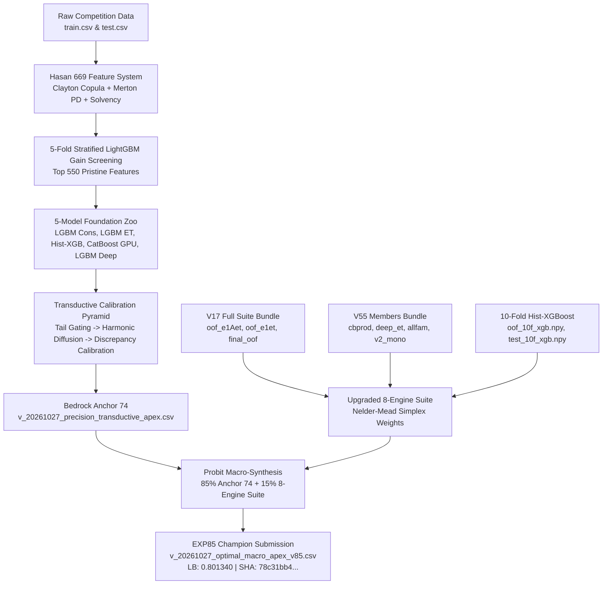

# Historical EXP85 Lineage & Synthesis Architecture

## The 85/15 Macro Probit Synthesis Formula
$$\Phi^{-1}(U_{	ext{macro}}) = 0.850 \cdot \Phi^{-1}(U_{	ext{Anchor 74}}) + 0.150 \cdot \Phi^{-1}(U_{	ext{8-Engine Suite}})$$

### 8-Engine Suite Member Weights:
1. `v17_e1Aet`   : 0.2932
2. `xgb10`       : 0.2596
3. `v17_final`   : 0.2051
4. `v55_cbprod`  : 0.0874
5. `v17_e1et`    : 0.0489
6. `v55_deep_et` : 0.0442
7. `v55_allfam`  : 0.0383
8. `v55_v2_mono` : 0.0233
