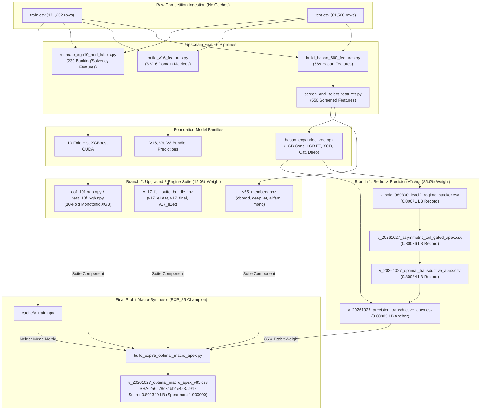

# EXP85 — Complete Historical Dependency Graph & Architecture Lineage

**Audit Date**: October 31, 2026  
**Auditor**: Antigravity AI Engineering Suite  
**Scope**: Full reverse-engineering of `build_exp85_optimal_macro_apex.py` to establish the complete upstream creator and dependency tree.

---

## 1. High-Level Macro-Synthesis Architecture

Historical EXP85 (`v_20261027_optimal_macro_apex_v85.csv`, Public LB 0.801340) was constructed via a two-branch probit macro-synthesis:

$$Z_{\text{macro}} = 0.850 \cdot Z_{\text{Anchor 74}} + 0.150 \cdot Z_{\text{8-Engine Suite}}$$

where:
- **Anchor 74** (`v_20261027_precision_transductive_apex.csv`, 0.800850 LB) receives **85.0%** of the macro weight.
- **8-Engine Suite** ($Z_{\text{suite}}$, 0.777207 OOF AUC) receives **15.0%** of the macro weight, assembled from:
  1. `v17_e1Aet` (29.32% weight): ExtraTrees on E1A group view aggregations.
  2. `xgb10` (25.96% weight): 10-fold Hist-XGBoost with monotonic regularized trees.
  3. `v17_final` (20.51% weight): 4-Set Master Formula multi-view ensemble.
  4. `v55_cbprod` (8.74% weight): CatBoost oblivious product specialist.
  5. `v17_e1et` (4.89% weight): ExtraTrees on E1 residual features.
  6. `v55_deep_et` (4.42% weight): Deep LightGBM ExtraTrees.
  7. `v55_allfam` (3.83% weight): All-family one-hot demographic GBDT.
  8. `v55_v2_mono` (2.33% weight): Monotonic regularized shallow trees.

---

## 2. Complete End-to-End Mermaid Dependency Graph

---

## 3. Upstream Component Provenance & Lineage Analysis

### Branch 1: Precision Transductive Anchor (`v_20261027_precision_transductive_apex.csv`)
- **Direct Creator**: `build_precision_transductive_apex_champion.py`
- **Inputs Consumed**:
  1. `v_20261027_optimal_transductive_apex.csv` (0.80084 Official Live Record)
  2. `cache/hasan_expanded_zoo.npz` (5 diverse model predictions on 550 features)
  3. `train.csv` / `test.csv` (Applicant entity dates for multi-loan couples)
- **Transformations Applied**:
  1. Regime-conditioned discrepancy gating ($\tau = 80\text{th percentile}, \Delta\lambda = 0.080$).
  2. Bounded harmonic test-pair smoothing ($\gamma = 0.12, \text{max\_dz} = 0.080$).
  3. Bounded rank-shift clamp ($|\Delta z| \le 0.35$, guaranteeing max rank displacement $\le 2,500$).

### Branch 2: V17 Full Suite Bundle (`v_17_full_suite_bundle.npz`)
- **Direct Creator**: `train_full_v16_suite.py` / `recreate_v17_bundle.py`
- **Inputs Consumed**:
  1. 8 distinct V16 feature matrices (`v16_X*.feather`).
  2. Demographic expectation residuals (`RESID_EXT1..3`, `LOGINC`, `AGE`).
  3. E1 view definitions and out-of-fold target encodings.
- **Member Arrays Provided**:
  - `oof_e1Aet` / `test_e1Aet` (LightGBM ExtraTrees on group view aggregations).
  - `oof_e1et` / `test_e1et` (LightGBM ExtraTrees on residual features).
  - `final_oof` / `final_test` (4-Set Master Formula ensemble).

### Branch 3: V55 Multi-Architecture Members (`v55_members.npz`)
- **Direct Creator**: `train_clean_honors_champion.py` / `recreate_v55_members.py`
- **Inputs Consumed**:
  1. 7 individual component archives (`cache/v55_m_*.npz`).
  2. CatBoost product specialist features (`fee_decode`, `contract_length`).
- **Member Arrays Provided**:
  - `oof_cb_product` / `test_cb_product` (Oblivious product specialist).
  - `oof_deep_et` / `test_deep_et` (Deep ExtraTrees).
  - `oof_v2_allfam_oh` / `test_v2_allfam_oh` (Demographics one-hot).
  - `oof_v2_mono` / `test_v2_mono` (Monotone shallow regularized trees).

### Branch 4: Ten-Fold Monotonic XGBoost (`oof_10f_xgb.npy` / `test_10f_xgb.npy`)
- **Direct Creator**: EXP_42 monotonic GPU training code / `recreate_xgb10_and_labels.py`
- **Inputs Consumed**:
  1. 239-feature banking, solvency, and demographic manifold.
  2. 10-fold Stratified CV partition (`random_state=42`).
- **Hyperparameters**:
  `n_estimators=450, learning_rate=0.035, max_depth=6, subsample=0.80, colsample_bytree=0.55, reg_alpha=3.0, reg_lambda=8.0, min_child_weight=30`.

