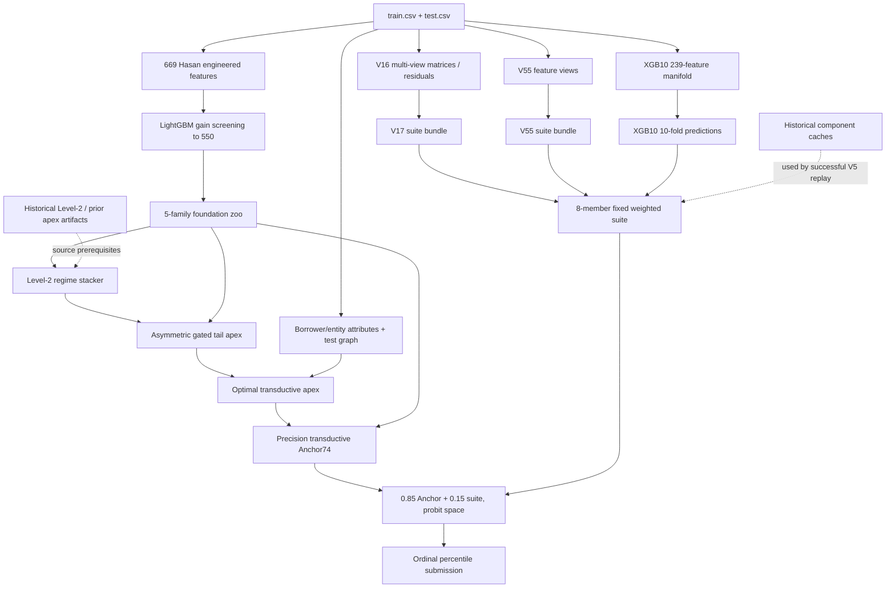

# Historical EXP85 Architecture

## Final composition

The historical output is a rank/probit meta-synthesis, not one end-to-end model:

1. Each of eight suite members is converted to a uniform rank and then a clipped Gaussian quantile.
2. Fixed suite weights are summed in probit space.
3. Anchor74 and the suite are combined as `Z = 0.85 * Z_Anchor74 + 0.15 * Z_Suite`.
4. The final latent score is ordinal-ranked to `(rank - 0.5) / 61,500` and written as the candidate target.

Suite weights:

| Member | Weight |
|---|---:|
| V17 `test_e1Aet` | 0.2932 |
| XGB10 | 0.2596 |
| V17 `final_test` | 0.2051 |
| V55 `test_cb_product` | 0.0874 |
| V17 `test_e1et` | 0.0489 |
| V55 `test_deep_et` | 0.0442 |
| V55 `test_v2_allfam_oh` | 0.0383 |
| V55 `test_v2_mono` | 0.0233 |

## Dependency graph

The graph distinguishes the intended raw-data ancestry (solid arrows) from the cache-backed ancestry used by the high-correlation replay (dashed arrow). Source reports describe the Anchor chain as 669 features → 550 selected features → five-family zoo → level-2/tail/optimal/precision apex. The recovered precision-anchor writer is a postprocessor: it reads a prior optimal apex, zoo predictions, and raw borrower attributes; it does not train all ancestors itself.

## Architecture generations that must not be conflated

- **Anchor-side foundation zoo XGBoost:** five-model zoo on screened features; reported 5-fold OOF AUC ~0.7534.
- **Standalone XGB10 suite member:** separate 239-feature manifold, 10 folds, 450 trees; historical reported OOF AUC 0.774331.
- **V17:** multi-view V16/E1/E1A streams. Selected final suite entries are `e1Aet`, `final`, `e1et`; its final is a rank blend of multiple V17 streams.
- **V55:** seven-member family; only four members enter the final suite.
- **EXP85:** fixed 85/15 probit composition and final ordinal projection.
- **Independent Phase 2:** raw-only two-model LightGBM/CatBoost model with engineered fee/product keys and nested target encodings. It is not a partial reproduction of the historical 85/15 graph.

## Key source-vs-report caveat

`03_PHASE_HISTORY\PHASE_3\experiments\reconstruct_transductive_pyramid.py` describes itself as consuming an independently rebuilt zoo, but source inspection shows `v_17_full_suite_bundle.npz`, `v55_members.npz`, and `test_10f_xgb.npy` are loaded from configured cache paths with historical fallbacks for final synthesis. Thus a source-rebuilt Anchor does not make the complete EXP85 synthesis raw-only.

## Replay result and scope

The Phase 3 Anchor74 SHA `315b0bd80e4698240a7a902648a157d84da1480dea77901cdb60892502a7b55b` plus the historical V17/V55/XGB suite caches reproduce the V5 candidate; the candidate/champion Spearman is `0.9999975815867501`. This is a hybrid replay. The observed historical reference score `0.801340` is reported in local historical material but is not independently verified through a platform record in this research stage.
